# Azure Machine Learning (Azure ML) — Complete MLOps Notes


---

## 1. Azure ML Workspace

### What is it?
An **Azure Machine Learning Workspace** is the central Azure resource used to organize and manage the resources and activities of an ML project: data assets, compute, jobs, environments, models, pipelines, and deployments.

It is **not just a folder**. It provides a managed place to track and work with ML resources and their relationships.

### What it commonly connects to
Depending on the workspace setup, supporting Azure resources can include:
- Storage account — data, artifacts, job outputs
- Key Vault — secrets and credentials
- Container Registry — container images
- Application Insights — operational telemetry

### Mental model

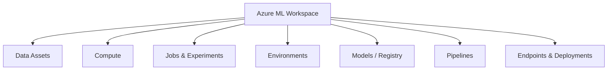

### Example
A team working on customer churn prediction keeps its data references, training jobs, environments, registered model versions, and deployed endpoint organized within its Azure ML workspace.

### Remember
- Workspace is the central management/organization resource.
- It does not itself perform model training; jobs run on compute.
- The workspace connects the pieces of an ML workflow.

---

## 2. Compute

### What is it?
**Compute is the processing capacity used to run ML workloads**—such as notebooks, data preparation, training, inference, or batch scoring.

### Main Azure ML compute options

| Compute | Purpose | Typical use |
|---|---|---|
| Compute Instance | Interactive managed VM for development | Notebooks, debugging, exploration |
| Compute Cluster | Managed pool of nodes that can scale | Training jobs, batch processing |

Compute clusters can be configured to scale up when jobs need capacity and scale down when idle, including to zero when configured. This helps manage cost.

### CPU vs GPU
- **CPU:** Often suitable for traditional tabular ML, preprocessing, smaller workloads.
- **GPU:** Useful for workloads that can leverage parallel GPU computation, such as deep learning and some large models. It is not automatically faster or cheaper for every task.

### Diagram

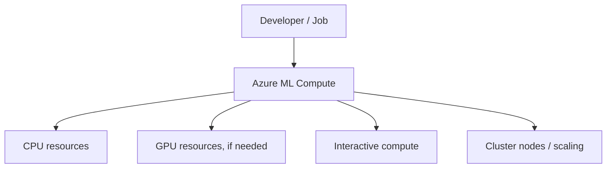

### Remember
Compute answers: **Where and with what resources does my code execute?**

---

## 3. Data Assets & Datastores

### Data Asset — what is it?
An **Azure ML Data Asset is a registered, identifiable reference to data**. Azure ML can track information such as its name, version, type, path/URI, description, and tags.

A Data Asset generally does **not** mean the dataset bytes are stored inside the asset record. The actual data resides in underlying storage, such as Blob Storage or Azure Data Lake Storage.

### Datastore — what is it?
A **Datastore is a connection/reference Azure ML uses to access an underlying storage location**. It can hold connection information without requiring users to repeatedly specify how to reach storage.

### Relationship

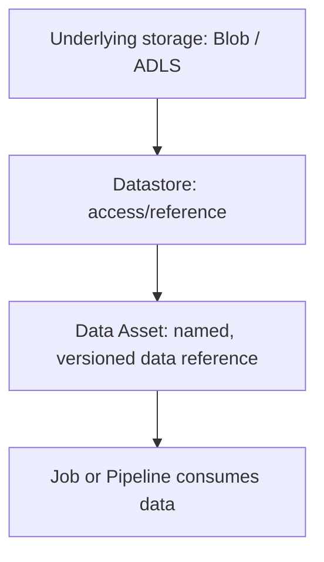

### Common Data Asset types
- **URI File:** Reference to an individual file.
- **URI Folder:** Reference to a folder/directory of data.
- **MLTable:** A definition describing how to load tabular data, often supporting transformations and multiple data sources.

### Download vs Mount
- **Download:** Data is copied to the job's local compute storage before use. Useful when local access is needed and the dataset is manageable.
- **Mount:** Remote data is exposed through a filesystem-like path. The job can read data without first copying the entire dataset up front. Reads still involve storage/network access and may use caching/buffering.

### Important caution about versions
Registering a new Data Asset version creates a tracked reference/version. If that version points to a mutable storage path, the contents at that path may still change. Versioned references alone do not guarantee immutable data bytes.

### Data Asset vs DVC
| Azure ML Data Asset | DVC |
|---|---|
| Managed data reference/version in Azure ML | Content-aware data versioning workflow |
| Fits Azure ML jobs and workspace | Fits Git-based project workflows and remote data storage |
| Can be used with DVC in the same project | Can complement Azure ML |

### Remember
- Storage holds the data.
- Datastore provides a way for Azure ML to access storage.
- Data Asset gives data a registered identity/version and a usable reference.

---

## 4. Jobs

### What is a Job?
A **Job is an execution submitted to Azure ML**. It describes what to run, the code, inputs and outputs, environment, and compute requirements.

Azure ML executes the workload on the configured compute and records execution details such as status, logs, metrics, outputs, and duration.

### Common job types

| Job type | Purpose |
|---|---|
| Command Job | Runs a command/script or workload |
| Sweep Job | Runs multiple trials with different hyperparameter values |
| Pipeline Job | Runs a connected workflow of multiple steps |

### Job lifecycle (simplified)

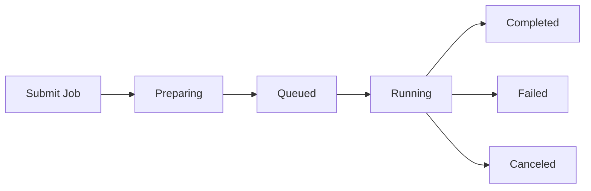

Exact statuses and transitions may vary.

### Job vs Experiment
- **Job:** One execution.
- **Experiment:** A grouping of related job runs to compare and organize results.

Think of an MLflow Experiment containing multiple Runs; Azure ML similarly groups executions for tracking.

### Example
Submit a training job using:
- `train.py`
- Iris Data Asset
- Environment containing scikit-learn
- Compute cluster
- Parameters such as `n_estimators=200`

The job runs remotely and records its results.

### Remember
Job answers: **What workload was executed, with which inputs/configuration, and what happened?**

---

## 5. Environments

### What is an Environment?
An **Azure ML Environment defines the software/runtime dependencies needed to execute a workload**.

It can specify:
- Python version
- Packages and package versions
- Conda/Pip dependencies
- Base Docker image
- Additional environment setup

### Why do we need it?
Your laptop and Azure compute are separate machines. Your local virtual environment is not automatically copied to Azure when you submit a job. The cloud job needs its own reproducible runtime.

An environment helps avoid problems such as:
- Missing packages
- Incompatible package versions
- “Works on my machine” differences
- Different runtime behavior across executions

### Curated vs Custom
- **Curated environment:** Azure/Microsoft-provided environments that already include common ML dependencies.
- **Custom environment:** You define the dependencies and/or base image to meet your project's needs.

### Typical workflow

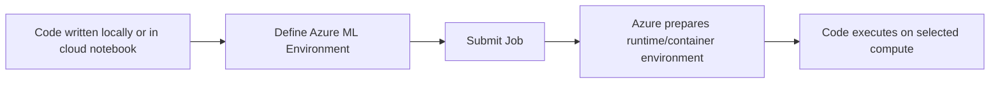

### Where does Docker fit?
Container technology is commonly used underneath to package the execution environment. Azure ML manages much of the environment preparation and job execution.

For typical managed Azure ML jobs, you do **not** need to manually create Kubernetes Pods or write Kubernetes Deployments. You can use a custom container image when you need more control.

### Remember
Environment answers: **Which software and runtime does this code need to run correctly?**

---

## 6. Model Registry

### What is it?
A **Model Registry stores and manages registered model artifacts and their versions**, along with useful metadata and lineage.

A model can be registered with information such as:
- Model name and version
- Artifact location
- Framework/type
- Description and tags
- Related job/run information when available

### Model lifecycle

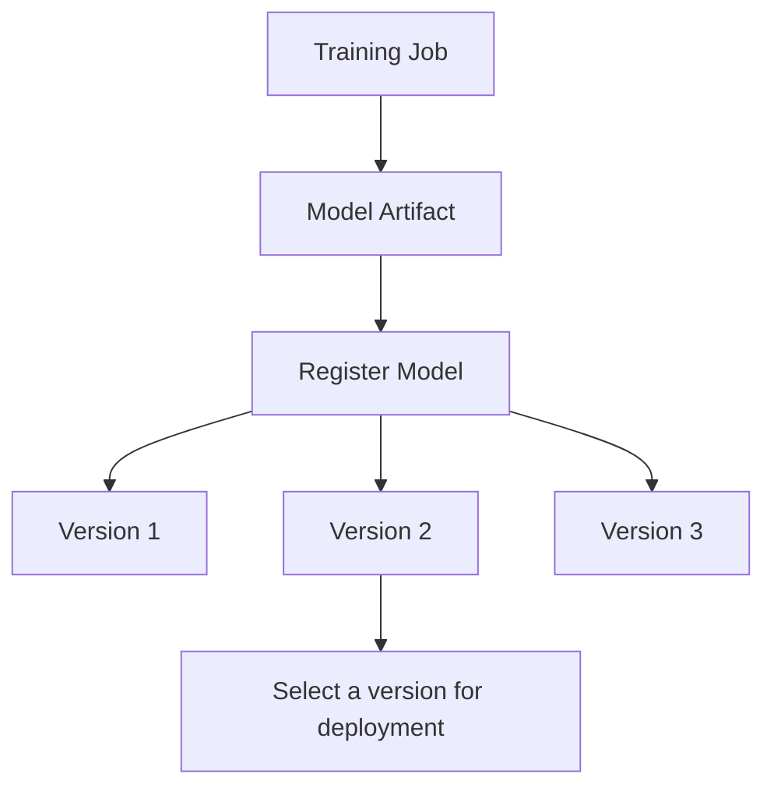

### Why version models?
Suppose three versions exist:

| Version | Validation result | Decision |
|---|---:|---|
| v1 | 82% | Retain for history |
| v2 | 91% | Candidate for production |
| v3 | 89% | Investigate / compare |

You can select a particular version for deployment, reproduce which model was used, and potentially roll back to an earlier retained version.

### Connection to MLflow
The core idea is the same as the Model Registry concept you learned in MLflow: register model artifacts, track versions, and manage the model lifecycle. Azure ML provides its own managed registry integration and workflow.

### Remember
Model Registry answers: **Which trained model artifacts do we have, what versions exist, and which one should be used?**

---

## 7. Azure ML Pipelines

### Why pipelines?
An ML workflow usually has multiple dependent tasks:

1. Validate data
2. Preprocess data
3. Engineer features
4. Train a model
5. Evaluate it
6. Register the model if it passes checks

Running these manually each time is repetitive and error-prone.

### What is a Pipeline?
An **Azure ML Pipeline is an orchestrated workflow made up of connected components/steps**. It defines the tasks, their dependencies, inputs/outputs, and execution configuration.

### Components
A component is an individual reusable pipeline step. It typically defines:
- Code or command to execute
- Inputs
- Outputs
- Environment
- Compute configuration

### Example pipeline

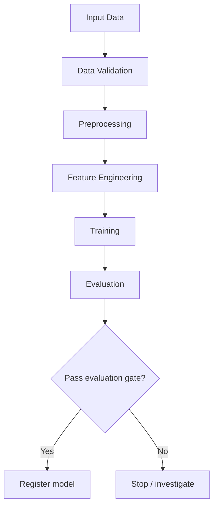

### How components communicate
A component writes outputs (often files/artifacts stored through Azure ML-managed or configured storage). A downstream component consumes those outputs as inputs.

Azure ML uses these dependencies to determine execution order. If a step needs another step's output, it must wait for that output to become available.

### Parallel execution
Independent steps can run in parallel when dependencies allow and compute capacity is available.

Example: After feature data is prepared, two different model-training components can train independently:

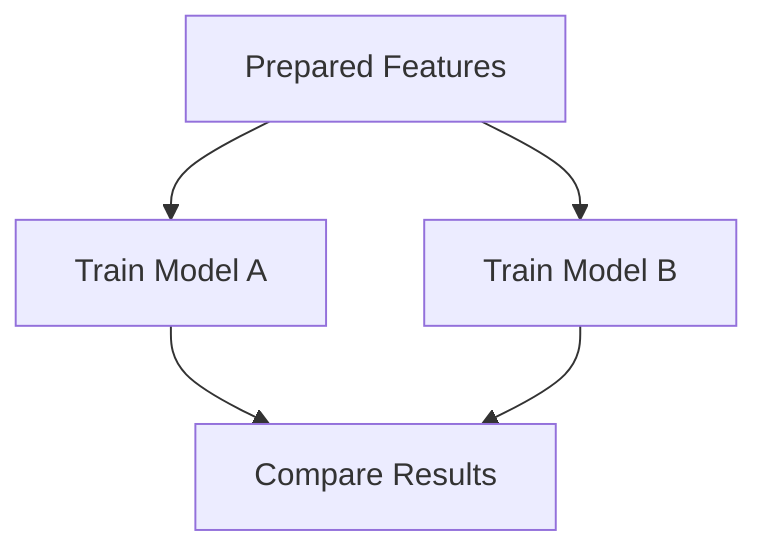

### Pipeline execution
When submitted, Azure ML broadly:
1. Accepts the pipeline definition.
2. Resolves dependencies.
3. Schedules components on configured compute.
4. Executes each step using its environment.
5. Captures logs, outputs, metrics, and status.

### Job vs Pipeline
| Job | Pipeline |
|---|---|
| Individual workload/execution | Orchestrated multi-step workflow |
| Can train one model or perform one task | Connects validation, preparation, training, evaluation, etc. |
| Executes a task | Coordinates task dependencies and data flow |

A pipeline is not a replacement for Jobs. Pipeline steps/components are executed as workloads and the pipeline coordinates them.

### Reuse and parameters
A pipeline can be reused with different inputs or parameters (dataset version, test split, algorithm, hyperparameters). The workflow structure stays the same while its configuration changes.

### Failure and reruns
If a component fails, dependent steps cannot proceed normally. Inspect its logs and configuration, fix the issue, and rerun. Depending on pipeline configuration and caching/reuse behavior, completed steps with reusable outputs may not need to run again.

### Remember
Pipeline answers: **How do I automate, connect, orchestrate, and repeat a complete ML workflow?**

---

## 8. Endpoints & Deployment

### Why deployment?
A trained model stored in a registry is an artifact. An application cannot automatically call that artifact to get a prediction. It needs a serving system.

### Deployment
**Deployment is the process of making a trained model available for inference in a configured runtime/serving environment.**

The deployment configuration commonly includes:
- Model version
- Environment/dependencies
- Inference/scoring code (how requests are processed)
- Compute resources
- Scaling and serving configuration

### Endpoint
An **Endpoint is the application-facing entry point** for sending inference requests to the model service. It exposes a request interface and, for online endpoints, an address/URL with configured authentication.

### Endpoint vs Deployment
| Endpoint | Deployment |
|---|---|
| Entry point/interface | Running model service/configuration behind the interface |
| Address, auth, traffic routing | Model, runtime, compute, scaling settings |
| Application sends requests here | Performs inference and returns results |

An endpoint can support multiple deployments, depending on endpoint type and configuration. This can enable traffic routing between model versions.

### Request/response example

Request:

```json
{
  "age": 24,
  "previous_purchases": 5,
  "product_price": 1200,
  "discount": 10
}
```

Response (illustrative):

```json
{
  "prediction": 1,
  "probability": 0.87
}
```

The model's input schema and scoring code must be designed to accept the request and produce the response. The example values are only illustrative.

### Online vs Batch Endpoints

| Online endpoint | Batch endpoint |
|---|---|
| Request-based, low-latency inference | Asynchronous bulk inference |
| Often individual/small requests | Large datasets/files |
| Response returned to calling application | Results written to output files/storage |
| Example: fraud score during a transaction | Example: score a customer database overnight |

### Multiple deployments / traffic
An online endpoint can be configured to route traffic between deployments. For example, a current model may receive most traffic while a candidate model receives a small portion. This can support canary testing—but traffic allocation by itself does not prove the candidate is better; evaluate outcomes and metrics.

### Compute, performance, and cost
Deployment performance depends on:
- CPU/GPU choice
- Instance size and memory
- Instance count
- Model size and load time
- Request volume and concurrency
- Latency requirements
- Scaling settings

A classical ML model may run efficiently on CPU; GPU should be selected when the workload benefits from it.

### Simplified deployment flow

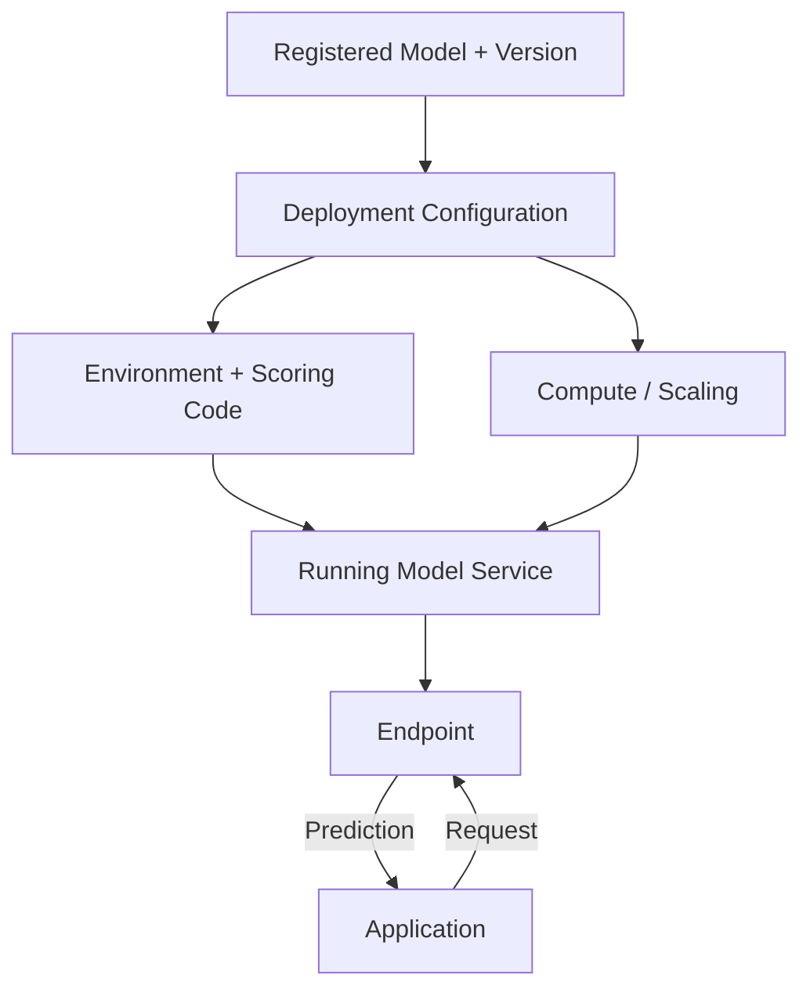

### Remember
Endpoint answers: **How can an application access the deployed model and request predictions?**  
Deployment answers: **Which model is running, in what environment, and on what compute?**

---

## 9. Responsible AI & Monitoring

These are related but distinct concerns:

- **Responsible AI:** Investigate whether model behavior is appropriate, explainable, fair, and trustworthy for its use.
- **Monitoring:** Observe the model/system after deployment to detect changes, degradation, and operational problems.

### Responsible AI concepts

| Concept | What it means |
|---|---|
| Fairness | Check whether outcomes differ unfairly across relevant groups |
| Explainability | Understand which features influence a prediction |
| Error analysis | Find where and for whom the model makes mistakes |
| Transparency | Document intended use, limitations, and behavior |
| Privacy | Handle personal/sensitive data appropriately |
| Reliability | Ensure the system behaves robustly within expected conditions |

High overall accuracy does not guarantee a responsible model. A model can be accurate overall but perform poorly for a subgroup or rely on inappropriate signals.

### Example
A loan-risk model has 94% overall accuracy, but its false-rejection rate is much higher for one demographic group.

A Responsible AI investigation could compare group-level performance, examine errors, inspect feature contributions, and test alternative inputs. The purpose is to understand and address the behavior—not simply to report the overall accuracy.

### Responsible AI analysis tools
Azure Responsible AI tooling/dashboards (availability depends on the supported workflow and model/data setup) can help with tasks such as:
- Model explanations
- Error analysis
- Data analysis
- Fairness assessment
- What-if analysis

These tools help developers investigate behavior; they do not automatically certify a model as fair or responsible.

### Monitoring after deployment
A model may perform well during evaluation but degrade after release because real-world data and behavior change.

Important monitoring categories:

| Monitoring area | What to detect | Example |
|---|---|---|
| Data quality | Missing, invalid, unexpected values | New records lack a required feature |
| Data drift | Input feature distributions change | Customer purchasing behavior shifts |
| Prediction drift | Output distribution changes | Model predicts “high risk” much more often |
| Performance | Quality metrics degrade when ground truth becomes available | Accuracy/recall drops |
| Operational health | Latency, failures, resource use | Requests time out or service errors increase |

### Data drift vs performance degradation
- **Data drift:** The incoming input distribution changes compared with the reference/training data. It is a warning signal, not proof that the model's accuracy has fallen.
- **Performance degradation:** Actual model quality gets worse, measured using ground truth labels and appropriate metrics when those labels are available.

### Monitoring feedback loop

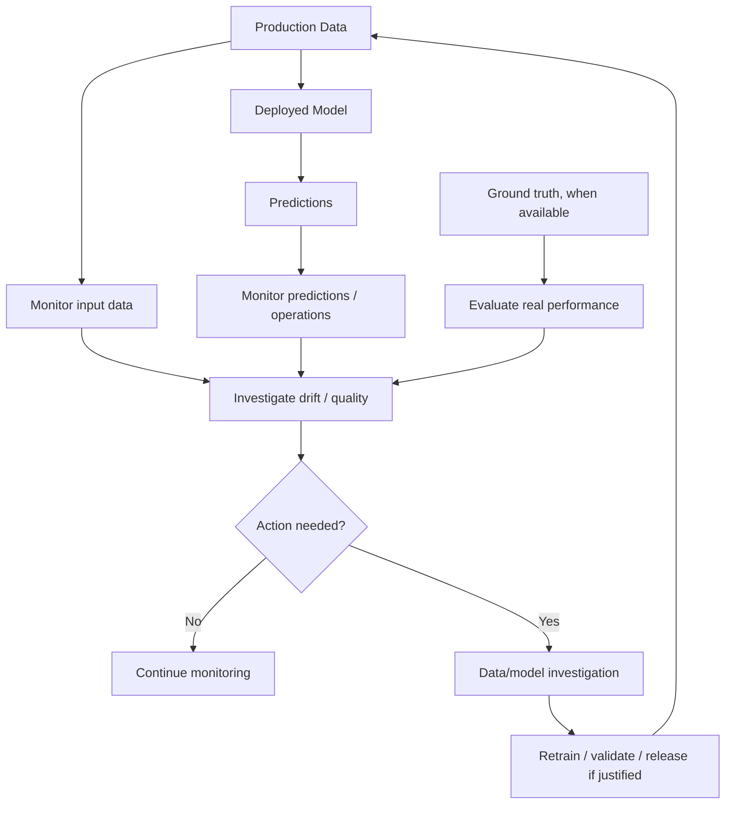

Monitoring does not mean automatically retraining whenever drift is detected. Investigate the cause, validate a candidate model, and deploy only if it meets release requirements.

### Remember
Responsible AI answers: **Is the model's behavior understandable, appropriate, and fair for its intended use?**  
Monitoring answers: **Is the model and its serving system continuing to behave as expected after deployment?**

---

## 10. CI/CD for ML

### CI — Continuous Integration
CI automates checks whenever code changes are proposed or pushed:
- Unit tests
- Code quality/lint checks
- Data/schema validation where appropriate
- Build checks

The goal is to catch defects early and consistently.

### CD — Continuous Delivery / Deployment
CD automates preparing a validated change for release or deploying it. In ML, release automation may involve more than application code because model artifacts, data, metrics, and evaluation gates matter.

### Typical ML CI/CD workflow

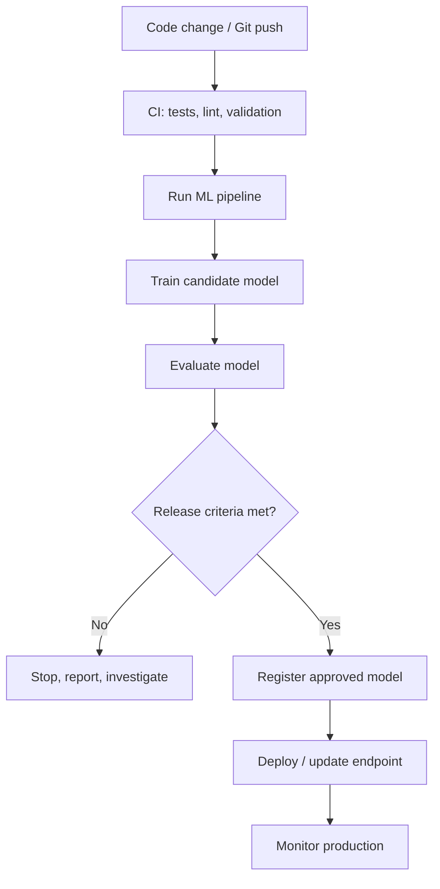

### Example release gate
A workflow might require:
- Tests pass.
- Input data schema is valid.
- Model metrics meet a predefined threshold.
- Required review/approval is completed.

For example, a team may decide that a candidate must meet a minimum validation metric before registration/deployment. The threshold must be selected for the actual problem; “accuracy > 95%” is not universally appropriate.

### Azure ML integration
Azure ML can be integrated with GitHub Actions or Azure DevOps to automate workflows such as pipeline submission, evaluation, model registration, and deployment. The exact implementation depends on the team's repository, permissions, and release design.

### Why CI/CD matters for ML
- Repeatable workflows
- Automated quality checks
- Less manual deployment work
- Controlled model releases
- Traceability of code and model versions
- Faster, safer updates

### Remember
CI/CD answers: **How do we automatically test, validate, and release code and ML models in a controlled, repeatable way?**

---

# 11. End-to-End Azure ML Lifecycle

This is the combined picture of all ten topics.

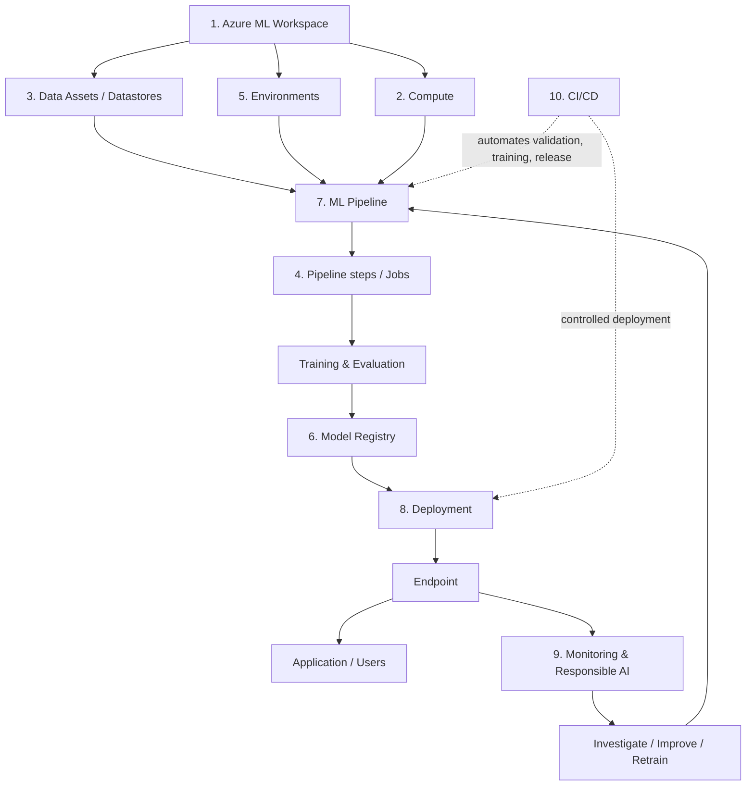

## Practical example: Product purchase prediction

1. **Workspace:** Create/organize the project in Azure ML.
2. **Compute:** Choose CPU/GPU resources for development and training.
3. **Data Assets:** Register the customer/product dataset and its reference/version.
4. **Jobs:** Execute data preparation or training workloads.
5. **Environments:** Specify Python and required libraries for repeatable execution.
6. **Model Registry:** Register trained models and keep versions.
7. **Pipelines:** Connect validation → preprocessing → features → training → evaluation → registration.
8. **Endpoints & Deployment:** Host a selected model so an ecommerce service can request predictions, or use batch inference to score many customers/products.
9. **Responsible AI & Monitoring:** Analyze model behavior and monitor input changes, predictions, quality, and service health.
10. **CI/CD:** Automate tests, pipeline runs, quality gates, registration, and controlled deployment.

---